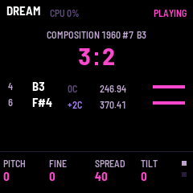

# DREAM

Firmware for the M-VAVE FM-1: pure sine tones, tuned as whole-number harmonics of one frequency, held for as long
as the FM-1 is on. A tribute to La Monte Young, with a look after Marian Zazeela's light.

- **Try it in your browser** (no FM-1 needed): <https://sethgraves.github.io/fm1-dream/>
- **Install it**: from [The Firmware Hub](https://thefirmwarehub.com/), or with M-Flasher and the `.fwsc` from
  [the latest release](https://github.com/sethgraves/fm1-dream/releases/latest)



Each tone's phase is a 32-bit integer stepping by exactly its harmonic number times the series' step, so the ratios
are exact and the tones never drift against each other, unless DRIFT asks them to. No filters, no effects, no
saturation: a linear sum with headroom.

## The pieces

PRESET chooses the piece, ALGORITHM its version.

| Piece | Versions | Source |
| --- | --- | --- |
| Composition 1960 #7 | B and F# at 3:2, in B2, B3, B4 | the score's two pitches, as a pure fifth |
| Dream House | the eight inclusory optional bases: 7; 8; 14:8; 18:14:8; 18:16:14; 18:16:14:8; 9:7:4; empty | the 15 tones from 224 to 288, worked from the title of *The Base 9:7:4 Symmetry in Prime Time…* |
| The Opening Chord | | The Well-Tuned Piano: Eb Bb C Eb F Bb, 4:6:7:8:9:12, Young's A (189/128) at 440 Hz |
| The Magic Chord | the Magic Chord; the Magic Opening Chord | The Well-Tuned Piano, its keys as sounded (Gann 1993) |
| Drift Study | | **tones chosen here**: 6:7:8 on B. The recordings' own tones are unpublished |
| Map of 49's Dream | | **tones chosen here**: a 60 Hz drone under 49:56:63:72, without 5, by Young's stated rules |
| Well-Tuned Piano Tuning | | the tuning's twelve pitches in three octaves, 36 tones at once |

## The controls

| Control | |
| --- | --- |
| PLAY | the drone on / off (it swells in and fades out) |
| PRESET, ALGORITHM | the piece, its version |
| K1 to K4 | PITCH (semitones), FINE (cents), SPREAD (stereo), TILT (dB per octave) |
| SELECT | the second page: DENSITY, BALANCE (the base against the rest), DRIFT, EVOLVE (the density breathing, 1 to 60 minutes) |
| SAVE | keeps it all for the next power-on |

The second page starts over with each new piece. The [manual](app/docs/MANUAL.md) has more.

## Build

```
git clone --recursive https://github.com/sethgraves/fm1-dream
python3 base/tools/build.py app --host                      # the host simulator
app/build/host/dream_host app/tests/basic.txt OUTDIR         # its tests: WAVs and screenshots in OUTDIR
python3 base/tools/build.py app --web                       # the browser emulator (Emscripten)
python3 base/tools/build.py app                             # app/build/dream.fwsc (JieLi toolchain, AC79 SDK)
```

Releases are built on GitHub from their tag by the shared FM-1 builder
([zvenson/fm1-build](https://github.com/zvenson/fm1-build)), with signed build provenance:
`.github/workflows/release.yml`. Every push to `main` builds a test package and the browser emulator:
`.github/workflows/dream.yml`.

## Licence and credits

MPL-2.0 (`LICENSE`, `LICENSING.md`). Built on [fm1-base](https://github.com/charlesvestal/fm1-base) by Charles Vestal
and [felucca-bsp](https://github.com/hugelton/felucca-bsp), from Felucca by Leo Kuroshita (Hügelton Instruments).

DREAM is an independent tribute. It is not affiliated with or endorsed by La Monte Young, Marian Zazeela or the MELA
Foundation, and contains no recordings, scores or artwork of theirs: only tunings, as published by Young and by
Kyle Gann ("La Monte Young's The Well-Tuned Piano", *Perspectives of New Music* 31/1, 1993). "M-VAVE" and "FM-1" are
trademarks of their owners, used only to say what hardware DREAM runs on.
